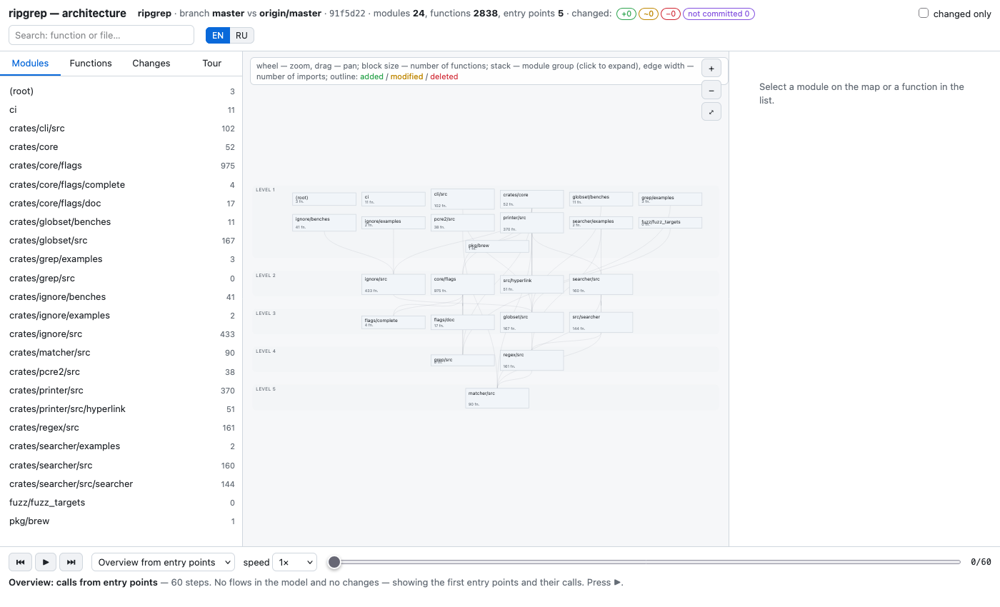
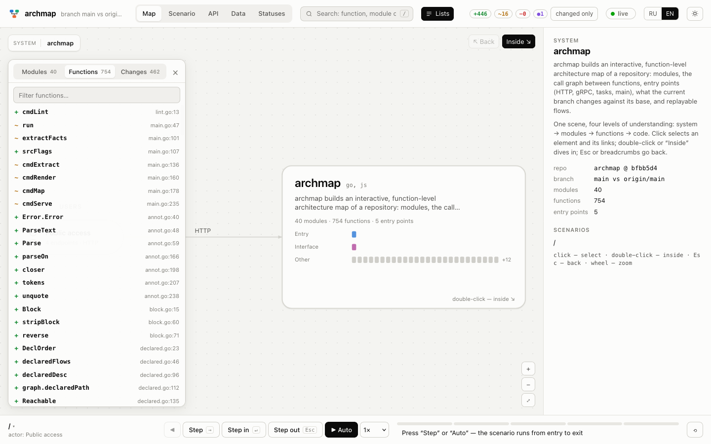
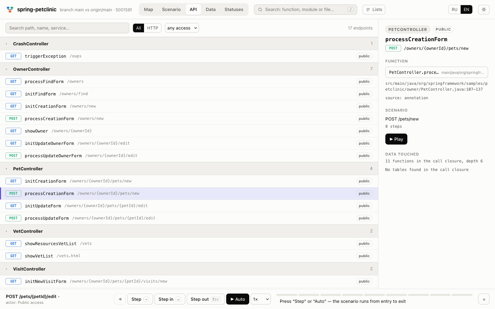
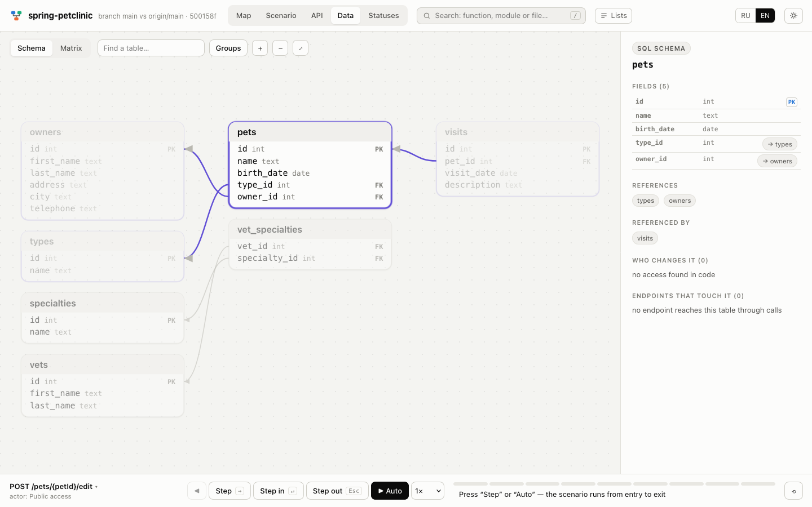
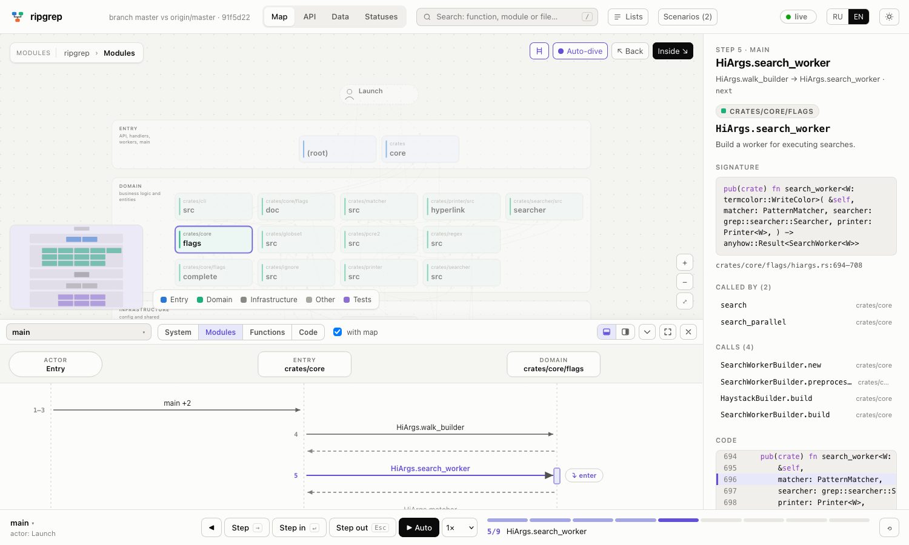
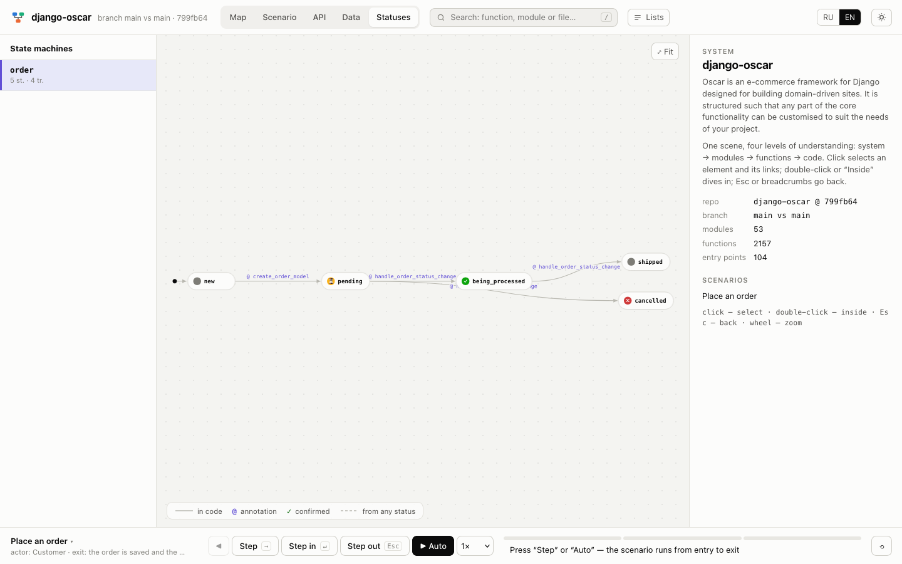
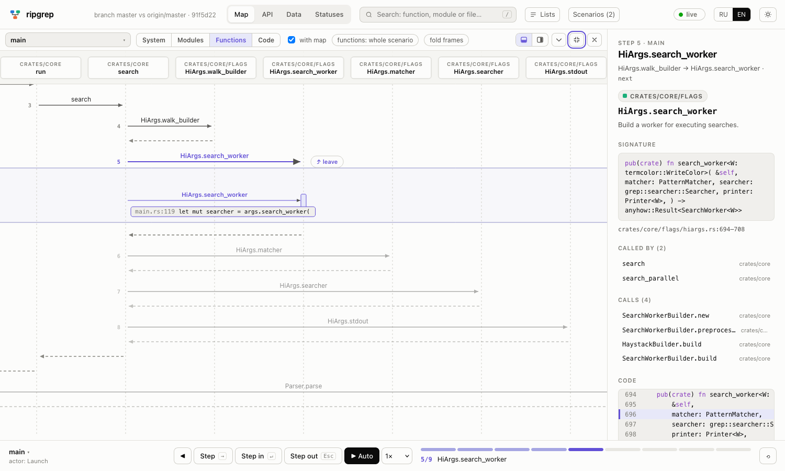

# archmap

archmap builds an interactive, function-level architecture map of a repository:
modules, the call graph between functions, entry points (HTTP, gRPC, tasks,
`main`), what the current branch changes against its base, and replayable
flows. The result is one self-contained, offline HTML file (or a live page that
follows your edits with `archmap serve`). Written in Go; 20 languages are parsed
with [tree-sitter](https://tree-sitter.github.io/).


*`archmap map` on [ripgrep](https://github.com/BurntSushi/ripgrep): modules grouped by dependency level.*


*`archmap serve` on this repository: the live map with the function list.*

The viewer UI is bilingual (English and Russian): it follows the browser
language, can be forced with `?lang=en` / `?lang=ru`, and has an EN/RU switch
in the header, plus a light and a dark theme. See [Views](#views) for what the
tabs show. How the viewer is built and how to add a view:
[docs/viewer.md](docs/viewer.md).

## Views

The header has four tabs (Map, API, Data, Statuses); a scenario that is playing
stays in sync across all of them (the player bar at the bottom is shared). The
sequence diagram of the scenario is not a tab but a panel of the Map (see below).

Gestures work as in Figma or maps in every view with a camera: a two-finger
scroll (or the mouse wheel, Shift+wheel for sideways) pans; a pinch or
Cmd/Ctrl+wheel zooms to the cursor, and only zooming dives into or leaves a level.
Lists and the scenario scroll normally.

- **Map** is one scene that goes through four **levels of understanding**:
  system (who uses it and what it talks to) -> modules -> functions of a module
  -> code. Click selects an element and its links; double-click or "Inside" dives
  in, Esc, "Back" or the breadcrumbs go up. A scenario plays through all four
  levels, so you can follow a request from the outside system down to the lines
  that run.
  The **sequence panel** docks on the map when a scenario, path or variant is
  chosen or plays (the diagram button in the top right of the map opens it by
  hand): it shows the same scenario as a sequence diagram, with lifelines for the
  actor, the service, modules or functions, the queue and external systems,
  `alt` blocks for the branches (`arch:on`), a pause where a step goes through a
  queue, and the effects and status changes of every step. It is nested like the
  map (see below). The panel sits at the bottom (default, 40% of the height) or
  on the right; drag the separator to resize it (double-click resets), fold it
  into a strip with the scenario name and progress, or open it full screen
  (the map is hidden; Esc brings it back). The place, size and fold are
  remembered. The map fits the current step into the part the panel leaves free.
  The header of the panel has a combobox with search to switch the scenario
  (paths, scenarios by actor, "Main" on top; the same list is in
  "Scenarios (N)"). `?view=sequence` opens the map with the panel full screen.
- **API** lists every endpoint (HTTP, gRPC, WebSocket, tasks, CLI) grouped by
  service, with filters by kind and access and a search. The card shows the
  request and response types, the function, the scenario to play and the tables
  the endpoint reaches through its calls; a table opens in the Data view.
- **Data** shows the schema as an ER diagram (tables, fields, foreign keys), a
  table card (who reads and changes it, which endpoints reach it) and an
  endpoints x tables matrix. An endpoint in the card opens in the API view.
  While a scenario plays, the tables the current step touches are marked.
- **Statuses** draws the state machines found in the code (status constants and
  enums, transitions from assignments, `UpdateStatusIfX(...)` calls and SQL,
  plus `arch:state` lines); the transition of the current step lights up.

Search (`/` or Ctrl/Cmd+K) finds functions, modules and files; the Lists
drop-down holds modules by layer, all functions and the branch changes.


*API: endpoints of [spring-petclinic](https://github.com/spring-projects/spring-petclinic) by controller, the card on the right.*


*Data: the schema of spring-petclinic with the selected table and its links.*


*The sequence panel at the bottom of the map of [ripgrep](https://github.com/BurntSushi/ripgrep): the map and the diagram show the same step.*


*Statuses: a state machine from `arch:state` lines on the same copy.*

### Nested scenario

The sequence panel has the same four levels as the map, and by default follows
the map's level ("link with the map"; switching either one moves the other):

- **System**: the actor, the service as one participant, the queue and external
  systems. Only the hand-offs between them are messages (entry -> service ->
  Kaspi -> ... -> reply); the steps inside the service fold into one message
  labelled with its first step and the number of folded steps.
- **Modules**: modules by layer, the queue and externals; one message per change
  of module.
- **Functions**: one message per call, for the whole scenario or for one module
  (the rest stays folded into modules).
- **Code**: as functions, with the line of the caller that makes each call.

The messages come from the steps of the flow (with `arch:step` labels: on the
function level per step, on the upper levels the label of the first step of the
fold) and from the call graph between them: the caller of a step is the previous
step or a frame below it on the call stack that reaches it. **Enter** on a message
(or a double-click) opens it in a frame one level deeper; at the function level
the frame holds the chain of calls from the caller to the step (up to 8 hops)
with the call lines. Frames nest; **Leave** folds one. A pinch or Cmd/Ctrl+wheel over
the diagram zooms it (a plain two-finger scroll or wheel just scrolls) and, past the same thresholds as the map's auto-dive, moves
the whole diagram a level in or out with the current step kept in view. The
current step is lit on every level (on the system level, the message that holds
it); branches and queue pauses are drawn on every level. Works the same for
annotated flows and for automatic scenarios.


*A scenario of [ripgrep](https://github.com/BurntSushi/ripgrep) in the full-screen panel, function level, with a message opened into a frame.*

Endpoints are found from routers (Go: gin, chi, echo and the like), decorators
(FastAPI, Flask, Express-style), Django/DRF urls, NestJS, Spring annotations,
Next.js routes, Rails routes, `.proto` files and background tasks; tables come from migrations, SQL schemas and ORM models, and the access
of a function to a table from queries (including named sqlc queries) and ORM
calls. As everywhere in archmap, only what is plainly visible is reported: a
project with no endpoints or tables gets an empty tab with a note, not a guess.

## How it explains code

Everything shown comes from the repository itself: no model, no hand-written
description files, no network.

- **Descriptions** of the project, modules and functions are taken from what the
  authors already wrote: the README and package manifests (`package.json`,
  `Cargo.toml`, `pyproject.toml`), package/module comments and
  docstrings, and the comment block directly above a function (a detached or
  trailing comment is not a doc; `//!` describes a module only).
- **Layers** (entry, UI, domain, adapter, infra, test) come from the structure:
  folder names (`handlers`, `services`, `repository`, `clients`...), what a
  module contains (entry points, `main`, screens) and, for Cargo workspaces,
  the folders inside `src` (a crate's own name says nothing). Clients of
  external services are told apart from storage.
- **Scenarios** start at entry points (HTTP/gRPC routes, tasks, `main`, pages)
  and follow the call graph, preferring steps that cross modules and layers and
  skipping error mappers, loggers and converters. The "Main" ones are ranked by
  how much of the system an entry point reaches (modules, external services and
  queues within six calls); a plain entry -> service -> repository path is
  demoted, and `main` wiring does not crowd out business flows.
- **Hand-offs through queues** link the code that puts a job on a queue to the
  code that runs it, so a scenario continues in the worker. They are drawn
  dotted and labelled "queue" in the viewer and stored as `async_callees` in
  `facts.json`. Recognised: Go River (`Insert`/`InsertTx`/`InsertMany` with an
  `XArgs{}` value, or a `Schedule*` wrapper around it, to the `Work` method taking
  `*river.Job[XArgs]`), Ruby Sidekiq/ActiveJob (`X.perform_async` ->
  `X#perform`), Python Celery (`task.delay()`/`apply_async()` -> the decorated
  task) and BullMQ (`queue.add('name')` -> `new Worker('name', handler)`).
  Calls made through other mechanisms are not linked. A scenario whose entry
  point has a hand-off within six calls always walks to it (the shortest
  meaningful chain, up to 12 steps instead of 9) and goes on in the worker.
- **Go calls follow types**: `s.repo.Save()` goes to the `Save` of the type of
  the field `repo` (also through a chain `s.a.b.M()` and for typed parameters),
  not to every `Save` in the project. Through an interface a call goes to the
  types that have all its methods (up to three; more is ambiguous and not linked,
  mocks are skipped); a type from outside the repository is not linked.

## Install

**Homebrew** (macOS and Linux):

```sh
brew install aidarbn/tap/archmap
```

**Prebuilt binaries**: download the archive for your OS and CPU from
[Releases](https://github.com/aidarbn/archmap/releases) (macOS arm64/amd64,
Linux amd64/arm64, Windows amd64), check it against `checksums.txt`, unpack and
put `archmap` on your `PATH`.

**From source**:

```sh
go install github.com/aidarbn/archmap/cmd/archmap@latest
```

A C compiler is required for this (tree-sitter grammars are built with cgo).

## Quick start

```sh
archmap map --root . --open        # one HTML file in .archmap/arch.html
archmap serve --root . --open      # live map that follows the repo
archmap extract --out facts.json   # only the facts (JSON)
archmap render --facts facts.json --out arch.html
```

## Commands

```sh
archmap extract [--root DIR] [--base REF] [--tests] [--no-src] --out facts.json
archmap render  --facts facts.json --out arch.html [--no-src]
archmap map     [--root DIR] [--base REF] [--tests] [--out FILE] [--open] [--no-src]
archmap serve   [--root DIR] [--base REF] [--tests] [--addr 127.0.0.1:0] [--open] [--no-src]
archmap lint    [--root DIR] [--format text|json] [--tests]
archmap version
```

- `extract` walks the repo (skipping `vendor`, `node_modules`, generated code and,
  unless `--tests`, tests), parses functions and calls, and writes `facts.json`.
  A short summary goes to stdout.
- `--base REF` is the ref to compare against; the default is the merge-base with
  the default branch. Uncommitted changes are included and marked.
- `render` turns facts into one HTML file; the semantic layer (module roles, layers, scenarios) is derived from the facts by heuristics.
- `map` does both; the default output is `<root>/.archmap/arch.html`;
  scenarios start at entry points and follow the call graph.
- `serve` is described below.
- Besides functions, `extract` finds the outside systems the code talks to
  (`externals`: databases, queues, caches, storage, payment/POS/auth providers,
  found from adapter modules, driver and SDK imports and base URLs) and state
  machines (`states`: status constants, enums and union types, with transitions
  taken from assignments, `UpdateStatusIfX(...)` calls and `SET status = '...'`
  SQL, including named sqlc queries). Only what is plainly visible is reported.
- Function bodies (cut to 60 lines) go into the output by default; `--no-src`
  leaves them out, for a page that leaves your machine. `serve` never embeds
  them: the page reads a body from disk on demand at `/src?fid=` (`--no-src`
  turns that endpoint off).
- `lint` checks `arch:` scenario markup, see [Annotating flows](#annotating-flows).

## Annotating flows

The automatic scenarios follow the call graph. To tell the story yourself, mark
functions with `arch:` lines in the comment right above them (a decorator or
annotation line between the comment and the declaration is fine). It works in
every supported language; the comment style is the language's own. The markup
feeds the scenarios and the sequence panel (flows, steps, branches) and the Statuses view
(`arch:state`); `archmap lint` checks it. The screenshots above of django-oscar
come from a temporary copy with exactly this kind of markup, for example:

```python
# arch:flow place-order "Place an order"
# arch:actor Customer
# arch:exit "the order is saved and the customer is notified"
def place_order(self, basket, total, ...):

# arch:step place-order "write the order header"
# arch:state order: new -> pending
def create_order_model(self, ...):
```

```go
// Request a Kaspi QR code for the order.
// arch:flow kaspi-pay "Pay an order by Kaspi QR"
// arch:actor Tablet
// arch:exit "order is paid or cancelled"
func (s *TabletsServer) RequestKaspiQRForOrder(ctx context.Context, req *pb.Req) (*pb.Resp, error) {

// arch:step kaspi-pay "ask Kaspi for a QR"
// arch:ext Kaspi
func (s *Service) requestQR(ctx context.Context, o Order) (QR, error) {

// arch:step kaspi-pay "poll the payment status"
// arch:on paid -> order-paid
// arch:on expired "cancel the order"
// arch:state order: payment_requested -> paid
func (w *CheckKaspiPaymentWorker) Work(ctx context.Context, job *river.Job[Args]) error {
```

```python
# arch:flow signup "Sign up"
# arch:actor User
def register(request):
    ...

# arch:step signup "send the welcome mail"
# arch:ext SendGrid
@shared_task
def send_welcome(user_id):
    ...
```

Directives:

- `arch:flow <id> "Name"` declares a scenario that starts at this function. Optional
  `arch:actor <who>` and `arch:exit "how it ends"` below it belong to that flow.
  Several flows on one function are fine; ids are letters, digits, `_`, `-`, `.`.
- `arch:step <flow-id> "caption"` makes the function a step of the flow. There are
  no step numbers: the order comes from the call graph (calls, then queue
  hand-offs) starting at the entry point, depth-first in call order.
- `arch:ext <System>[, <System>]` the function talks to an external system.
- `arch:on <condition> -> <flow-id>` the story branches into another flow;
  `arch:on <condition> "text"` is an outcome of the step.
- `arch:state <entity>: <from> -> <to>` a state transition.

Declared scenarios come first in the map (kind `declared`, with `id`, `actor`,
`exit`, per-step `labels` and `branches`) and replace the automatic scenario of
the same entry point; the rest follow as before. Each function also carries the
parsed markup as `arch` in `facts.json`.

### Journeys and variants

There are more scenarios than entry points, in two directions.

**Journeys** are paths over several flows: what a client does from the first call to the
last. The backend shows only part of it (a payment starts a queue job that confirms the order),
the rest is the client's order of calls (create the order, then ask for a QR, then confirm),
which only you know. Write it on the entry point of the first flow:

```go
// arch:flow order-create "Create an order"
// arch:actor Tablet
// arch:journey guest-pay "Guest pays by QR"
// arch:actor Guest
// arch:exit "the order is in the kitchen"
func (s *Server) CreateOrder(...) {

// arch:flow qr-request "Request a QR"
// arch:then guest-pay qr-request
func (s *Server) RequestQR(...) {
```

- `arch:journey <id> "Name"` starts a journey; its first flow is the nearest `arch:flow` of the
  same comment. `arch:actor` and `arch:exit` below it belong to the journey (above it, to the
  flow). Without them the journey takes the actor of its first and the exit of its last flow.
- `arch:then <journey-id> <flow-id> [> <flow-id> ...]` appends flows, on any function; the order
  is the source order (file, line) of the `then` lines.
- List form on one line: `arch:journey <id> "Name": flowA > flowB > flowC`.

Links between neighbouring flows come from the code when it has them (`arch:on … -> flow`, or
a queue: a step puts a job whose handler is another flow's entry point) and are `declared`
otherwise. `archmap lint` warns about such a gap; it is fine when the client calls the flows in turn.

Automatic journeys are built too: from every flow that a person starts (actor is not
cron/queue/system) a walk over the `on` and queue links, at least two flows, no cycles; paths
with a shared prefix are one journey with a branch. Declared journeys come first.

**Variants** are the paths through the forks of one flow. Each `arch:on` is a fork at its step
and ends its variant, either in another flow or with the text outcome; the main variant runs
through all the steps. The name is built from the condition (`paid → to the cash desk`). A flow
has at most 12 variants (outcomes with the same end are folded together first). A flow without
`arch:on` has no variants. The data is in the model, see `docs/viewer.md`.

**In the viewer** the scenario list (the "Scenarios (N)" button, the combobox in the header of the
sequence panel, the system panel) has three levels: "Through paths" (name, actor, the chain of flows with
an icon for each transition: condition, queue, written by hand), "Scenarios" (grouped by actor
as before), and under a scenario its foldable "Variants" (the main path first, `one of: …` for
folded outcomes, "…N more"). Search looks through all three.

- Playing a path runs its flows one after another; between two flows a plate says how the next
  one starts ("→ through the queue", "→ on condition …", "next the client calls …"), and the map
  and the sequence panel show the overall progress ("flow 2/5 · step 3/7") and a label with the
  name of the path.
- Playing a variant takes its forks by itself. At the end a plate shows the outcome, or offers
  "Go to the scenario" when the variant ends in another flow.

### Lint

```sh
archmap lint [--root DIR] [--format text|json] [--tests]
```

Checks the markup and exits with 1 when something is wrong, so it fits CI:
syntax errors (with the line); a `step` or `on -> …` that names a flow that is
not declared; a flow id declared twice; a step that cannot be reached by calls
from the flow's entry point; `ext` and `state` of a wrong shape; a journey that names a
flow that is not declared, a `then` of an unknown journey, a journey id declared twice. A gap
in a journey (two neighbouring flows with no link in the code) is a warning and does not change
the exit code.

## serve: live map while you code

```sh
archmap serve [--root DIR] [--base REF] [--tests] [--addr 127.0.0.1:0] [--open] [--no-src]
```

Prints a `http://127.0.0.1:PORT/` URL (`--open` opens it). The page is the same
viewer as `map`, but it follows the repo:

- The server polls file mtimes and sizes (every 400 ms) for source files, the
  `.git` HEAD/index/branch ref, waits until the tree has been
  quiet for 300 ms, then re-extracts and pushes an update over SSE (`/events`);
  the page reloads `/data.json`. Polling was chosen over fsnotify: no
  dependency and no inotify/kqueue watch limits on big trees.
- A rebuild re-parses only files whose content changed; resolving calls and
  imports is redone in full. A failed rebuild keeps the last good map and shows
  the error.
- The browser keeps what you were doing across an update: the view (tab), level,
  selection, camera (position and zoom of each level), opened module groups, the
  changed-only filter, the scenario and the playback position, the scroll of the
  right card. Functions that are new or whose body (or change status) changed,
  and their modules, flash on the map, in the right card, in the code and in the
  lists. The header shows live (with time, rebuild time and the number of
  changed functions), rebuilding, or the error text; it reconnects by itself.
  Function code is read from `/src` on demand (not embedded); the code of a
  changed function is re-read.
- All four tabs and the sequence panel follow the update (the endpoint list, the ER
  diagram, the state machines and the diagram are rebuilt from the new facts; the
  panel keeps its place, size and the open frames of the diagram).
- Search (`/` or Ctrl/Cmd+K) finds functions, modules and files; Enter opens the
  function on the map, Shift+Enter in its code. The Lists drop-down holds
  modules by layer, all functions with a filter, and the branch changes.
- Only loopback addresses are accepted for `--addr`; requests with a foreign
  `Host` header and non-GET methods are rejected.
- `/` renders the same page as `map` plus a `serve` key in the data; a static
  `arch.html` is unchanged and works offline as before.

Limits: the watcher ignores `.gitignore` (an ignored source file that changes
causes a harmless rebuild); a change in a file's callers only shows as a flash
on the edited function, not on its callers.


## Languages

- **Hand-written parsers** (most precise): Python, Go, JS/TS (JSX/TSX), Swift,
  Kotlin. Source: `internal/lang/<name>`.
- **Through tree-sitter tags queries** (`internal/lang/generic`): Java, Rust,
  Ruby, C#, PHP, Scala, Dart, Elixir, Haskell, C, C++, Lua, Bash, Zig, OCaml (`.h` is parsed as C++; quoted
  `#include`s are imports, `<system>` ones are not). A language is one `Spec` (name, extensions, grammar, tags query,
  optional import query); the shared code turns `@definition.*` /
  `@reference.call` captures into functions, owners, line ranges, signatures,
  doc comments, calls with receivers and imports. Expect less precision than
  the hand-written parsers (no decorators/bases, no entry-point hints).

The registry (`internal/lang/all`) is the only source of file extensions.

### Contributing: adding a language

1. Add the grammar's Go binding module (`go get github.com/tree-sitter/tree-sitter-<lang>`).
2. Copy its `queries/tags.scm` to `internal/lang/generic/queries/<lang>/tags.scm`,
   adapt it (captures: `@definition.function|method|class|interface|module|impl`
   with `@name`, `@reference.call` with `@name`, optional `@doc`) and keep the
   source and licence in the file header. Optionally add `imports.scm` with
   `@import` / `@import.relative` / `@import.mod` (and `@wild`).
3. Append one `Spec` to `Specs()` in `internal/lang/generic/langs.go`.
4. Add a test next to `generic_test.go` with a mini source and the expected
   functions, owners, line ranges, calls and imports, and run
   `go test ./... && go vet ./...`.
5. Check it on a real repository: `archmap extract --root <repo> --out x.json`.

A language needing hand-written logic (decorators, bases, entry points) gets its
own package like the first five.

## Limitations

- Calls are resolved by name and receiver, which is an approximation: expect
  some extra or missing edges. Common method names (`get`, `Close`, ...) are not
  linked.
- The binary is about 60 MB because all 20 tree-sitter grammars are linked in.
- A language without a parser (see Languages) contributes nothing to the map.
- Change status needs git.

## License

MIT
