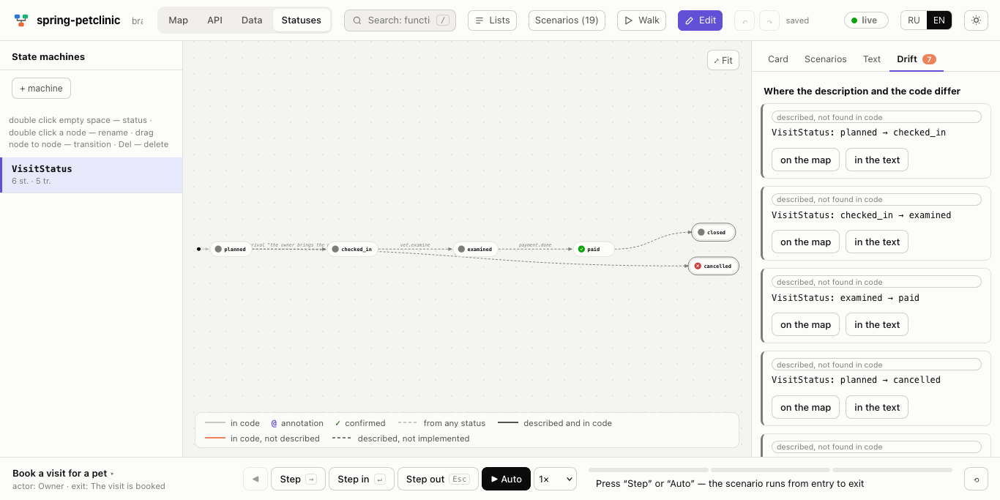
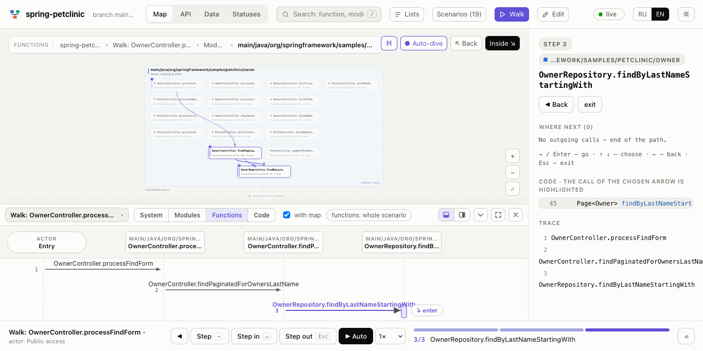

# archmap

archmap builds an interactive, function-level architecture map of a repository:
modules, the call graph between functions, entry points (HTTP, gRPC, tasks,
`main`), what the current branch changes against its base, and replayable
flows. The result is one self-contained, offline HTML file (or a live page that
follows your edits with `archmap serve`). Written in Go; 20 languages are parsed
with [tree-sitter](https://tree-sitter.github.io/).


*`archmap map` on [ripgrep](https://github.com/BurntSushi/ripgrep): modules grouped by dependency level.*


*`archmap serve` on this repository: the live map with the function list.*

How the viewer is built and how to add a view: [docs/viewer.md](docs/viewer.md).

## Interface

The page is a desktop layout in the manner of Figma (≥ 1200 px wide; there is
no mobile layout): a thin toolbar on top and three docked columns under it —
the sidebar, the canvas, the inspector. Nothing floats over the map but the
crumbs and the zoom block in its corners. A light neutral theme (a dotted grey
canvas, white panels, 1 px borders, one accent colour, small radii, no panel
shadows) and a dark one.

- **Toolbar** (40 px): at the left the logo (a click goes back to the whole
  system), the live dot under `archmap serve` and the sidebar toggle; in the
  centre the open scenario with its navigation (only in the scenario window,
  below); at the right a small **⋯**: **API**, **Data**, **Statuses**,
  **Language**, **Theme** and, on a branch with changes, **Only changed**.
  There is no search.
- **Sidebar** — the base of the page, a docked column at the left (240 px; drag
  its right edge for 200–420 px, double-click for the default, remembered by
  the browser; the toolbar button or `[` hides it). On top the project name
  with the branch under it, then a compact **filter** that narrows the whole
  tree, then the **full navigation of the project as one tree**, like the
  layers of Figma — names only, one line each (the full name in the tooltip), a
  small grey counter on sections and groups: **System** → **Users** (actors) →
  **Modules** by layer (Entry, Domain, Adapters, Infrastructure …; a module
  unfolds into its functions) → **Outside systems** → **Data** (tables) →
  **API** (services → endpoints) → **Statuses** (entities) → **Scenarios**
  (through paths → their scenarios, then the scenarios by who starts them;
  technical scenarios are not listed). A click selects the node on the map
  (going to its level) or opens its view in the centre (Data, API, Statuses),
  and the inspector shows it. The tree follows a selection made on the map or
  in a view: it unfolds down to the selected node and scrolls to it.
- **Scenarios open apart**, in a window of their own: a click on a path or a
  scenario (in the tree or in a card) opens one reused browser window
  `archmap-scenario` — the same page with `#journey=<id>` / `#flow=<id>` and
  `&solo=1` (works for a static file and under `serve`; when the pop-up is
  blocked, a new tab). The main window never plays a scenario: its map stays the
  map. The scenario window has no sidebar: the toolbar with the scenario name
  and **Overview · ← Step k/N →** in the centre (✕ closes the window), the map
  of its participants only, the inspector at the right. A reload shows the same
  scenario.
- **Breadcrumbs** "where I am" sit small in the top-left corner of the canvas
  (system › modules › module › function — a click goes back up; on a view:
  system › API).
- **An open path or scenario** (the scenario window) is the same system,
  simplified: it shows **only what takes part in it** — the actors
  that start its flows (in a column at the left), the modules of its steps, the outside systems they call,
  the database when a step reads or writes, the queue at a hand-off. Nothing
  else is drawn. The participants keep the look of the map and their layer
  bands and go left to right in the order the path reaches them; zooming into a
  module shows only its functions on the path. Closing it brings the whole map
  back where it was. A scenario opened from a card shows the same way.
- **Map**: one scene with four levels — system (who uses it and what it talks
  to) → modules → functions of a module → code. A click selects an element and
  its links, a double click dives in, Esc or the breadcrumbs go up. A two-finger
  scroll (or the wheel) pans. A pinch or Cmd/Ctrl+wheel zooms, and zooming into
  a card far enough dives into it (system → modules → the functions of a module →
  code); zooming a level out far enough goes back up, and the crumbs follow. There
  is no switch for it. A small − / fit / + block sits in the bottom-right corner. Under the name, an
  actor, an outside system, a module or a function shows one short line of its
  description when the code has one (an actor: `61 scenarios · Admin service…`;
  the count leaves out technical scenarios).
- **Inspector** — a docked column at the right (280 px; drag its left edge for
  240–480 px; `]` or Cmd/Ctrl+. hide and show it), like the Design panel of
  Figma: sections with small titles, dense "label — value" rows. It is always
  there: **with nothing selected it shows the system overview** — what the
  system does (the project description), the counts, who uses it and which
  outside systems it talks to, each with a line of description (a name opens
  its card). A selection (actor, outside system, module, function, step,
  endpoint, table, status) shows its card: first what the element does, then the
  details and the steps. Where the
  code has no description, a module or function card shows a **summary of the
  structure** instead, marked as such (entry points, called from, calls, tables
  written and read, outside systems) — facts only, no guessed meaning. An
  **actor** card says what it is (protocol, service, where it is defined
  `file:line`, the implementing type), lists its through paths and scenarios and
  then its endpoints grouped by service, each with its description; a click on
  an endpoint opens its scenario (▶) or its function. Module and function cards
  list the **scenarios through them** — the only way to a scenario that is not a
  through path. Cards also lead to the views: an actor → **API**, Postgres or a
  table → **Data**, a module or function that changes a status → **Statuses**.
- **Fewer scenarios, fewer steps.** Lists and counters leave out technical
  scenarios: health / version / docs routes, metrics, test, cleanup and
  bootstrap workers, root catch-all handlers, one-step scenarios without a
  description, automatic scenarios without a description outside the top ones
  (a flow of a through path always stays). A scenario plays only its meaningful
  steps: marked or described ones, moves to another module, outside systems,
  table reads and writes, queue hand-offs, status changes; error constructors,
  loggers, metrics, converters, getters and plain calls inside one module fold
  into the step before them. A through path does not replay a step an earlier
  flow of it already played. The rules are in `internal/autosem/trim.go`.
- **Scenarios** go only by hand: there is no auto play and nothing starts by
  itself. Pick a path or scenario in the sidebar, or in an actor, module or
  function card: its window opens on the **overview** (step 0). The inspector says what it
  does (the description of `arch:flow` / the doc of the entry point / the rpc
  comment), who starts it, the entry (endpoint or task), how it ends, the
  number of steps and forks, and its participants — modules and outside systems
  with a line of description each, then the tables; a path lists its scenarios
  in order, each with its line (a click goes to its first step). The map shows
  the whole path evenly, no step lit, and the toolbar reads `<name>  Overview ·
  ← N steps  Start →  ✕`. → (or Start) goes to step 1, then it is `<name>
  Overview · ← Step k/N →  ✕` and the inspector shows the step; ← from step 1
  (or Overview, Home) returns to the overview. The whole path is drawn on the level you are on. The current leg is
  bright with a bigger number and glows once, passed legs are a calm accent, the
  coming ones pale and dashed with their numbers, the rest of the map is dimmed;
  on the modules the module of the step lights up, inside a module the function.
  → and ← (or the arrows of the toolbar) step, a click on a leg or its number goes
  to that step (the tooltip says `Step k: …`), a click on the node of the next
  step steps forward. Home goes back to the overview, Esc goes a level up, then
  to the overview. The camera
  moves smoothly and only when the step is off screen. At a fork the branches
  that go on in another flow are pale legs (and buttons in a strip on top of the
  inspector, with the plate between flows and the outcome): a click
  takes one. Outcomes that end the story (an `arch:on` without a flow: an error,
  "still waiting") are folded into one pale **+N branches** mark on the node; a
  click unfolds them.
- **API** (⋯ → API, or an actor card) lists the endpoints grouped by service; the card shows
  the request and response types, the function, the scenario from it and the
  tables it reaches through its calls (a table opens in Data).
- **Data** (⋯ → Data, a table in a card, or Postgres on the map) is the schema
  as an ER diagram. The table card shows the **description of the table** under
  its name and every field with its type, NULL / NOT NULL, PK / reference and
  **its description** — taken from the code, never made up: `COMMENT ON TABLE /
  COLUMN`, `-- …` comments on or right above a column or `CREATE TABLE` / `ALTER
  TABLE … ADD COLUMN` (goose Down parts ignored, the last description wins), doc
  comments of Go struct fields mapped to the table (by the struct name or its
  `db` / `gorm` column tags), Django `help_text` / `verbose_name` and model
  docstrings. Then who reads and changes the table and which endpoints reach it.
- **Statuses** (⋯ → Statuses, or "Statuses ↘" in a card) draws one state machine
  found in the code (status constants and enums, transitions from assignments,
  `UpdateStatusIfX(...)` calls and SQL, plus `arch:state` lines); the transition
  of the current step lights up.

The interface is bilingual (English and Russian): it follows the browser
language, `?lang=en` / `?lang=ru` force it, ⋯ → Language switches it. Light and
dark themes: ⋯ → Theme, `?theme=dark`. `?view=api|data|status` opens a view.

The scenario sheet, the sequence panel, Walk and the Edit mode (below) are kept
in the sources but are not part of the current page.


*Data: the schema of spring-petclinic with the selected table and its links (older screenshot).*

Endpoints are found from routers (Go: gin, chi, echo and the like), decorators
(FastAPI, Flask, Express-style), Django/DRF urls, NestJS, Spring annotations,
Next.js routes, Rails routes, `.proto` files and background tasks; tables come from migrations, SQL schemas and ORM models, and the access
of a function to a table from queries (including named sqlc queries) and ORM
calls. As everywhere in archmap, only what is plainly visible is reported: a
project with no endpoints or tables gets an empty tab with a note, not a guess.

## How it explains code

Everything shown comes from the repository itself: no model, no hand-written
description files, no network.

- **Descriptions** of the project, modules and functions are taken from what the
  authors already wrote: the README and package manifests (`package.json`,
  `Cargo.toml`, `pyproject.toml`), package/module comments and
  docstrings, and the comment block directly above a function (a detached or
  trailing comment is not a doc; `//!` describes a module only). Tool directives
  in that block are not prose and are dropped: `//nolint`, `//go:…`, `//lint:`,
  `# noqa`, `# type: ignore`, `// eslint-…`, `// @ts-…`, `// swiftlint:`,
  `// MARK:` and `arch:` markup.
- **Endpoints** are described by the comment right above `rpc X(...)` in the
  `.proto` file, else by the doc comment of the handler function. A **service**
  (`service X {`) by the comment above it, else the doc comment of the type that
  implements it, else that type's package doc. An **actor** takes the description
  from `arch:actor <Name> "…"` (see below) when the code gives one, else that of
  the service most of its endpoints belong to. An **outside system** (Kaspi,
  Postgres, …) takes the package doc of its client module. Nothing is made up:
  without a comment there is no description, and `archmap lint --missing-docs`
  lists where one is missing.
- **Layers** (entry, UI, domain, adapter, infra, test) come from the structure:
  folder names (`handlers`, `services`, `repository`, `clients`...), what a
  module contains (entry points, `main`, screens) and, for Cargo workspaces,
  the folders inside `src` (a crate's own name says nothing). Clients of
  external services are told apart from storage.
- **Scenarios** start at entry points (HTTP/gRPC routes, tasks, `main`, pages)
  and follow the call graph, preferring steps that cross modules and layers and
  skipping error mappers, loggers and converters. The "Main" ones are ranked by
  how much of the system an entry point reaches (modules, external services and
  queues within six calls); a plain entry -> service -> repository path is
  demoted, and `main` wiring does not crowd out business flows.
- **Hand-offs through queues** link the code that puts a job on a queue to the
  code that runs it, so a scenario continues in the worker. They are drawn
  dotted and labelled "queue" in the viewer and stored as `async_callees` in
  `facts.json`. Recognised: Go River (`Insert`/`InsertTx`/`InsertMany` with an
  `XArgs{}` value, or a `Schedule*` wrapper around it, to the `Work` method taking
  `*river.Job[XArgs]`), Ruby Sidekiq/ActiveJob (`X.perform_async` ->
  `X#perform`), Python Celery (`task.delay()`/`apply_async()` -> the decorated
  task) and BullMQ (`queue.add('name')` -> `new Worker('name', handler)`).
  Calls made through other mechanisms are not linked. A scenario whose entry
  point has a hand-off within six calls always walks to it (the shortest
  meaningful chain, up to 12 steps instead of 9) and goes on in the worker.
- **Go calls follow types**: `s.repo.Save()` goes to the `Save` of the type of
  the field `repo` (also through a chain `s.a.b.M()` and for typed parameters),
  not to every `Save` in the project. Through an interface a call goes to the
  types that have all its methods (up to three; more is ambiguous and not linked,
  mocks are skipped); a type from outside the repository is not linked.

## Install

**Homebrew** (macOS and Linux):

```sh
brew install aidarbn/tap/archmap
```

**Prebuilt binaries**: download the archive for your OS and CPU from
[Releases](https://github.com/aidarbn/archmap/releases) (macOS arm64/amd64,
Linux amd64/arm64, Windows amd64), check it against `checksums.txt`, unpack and
put `archmap` on your `PATH`.

**From source**:

```sh
go install github.com/aidarbn/archmap/cmd/archmap@latest
```

A C compiler is required for this (tree-sitter grammars are built with cgo).

## Quick start

```sh
archmap map --root . --open        # one HTML file in .archmap/arch.html
archmap serve --root . --open      # live map that follows the repo
archmap extract --out facts.json   # only the facts (JSON)
archmap render --facts facts.json --out arch.html
```

## Commands

```sh
archmap extract [--root DIR] [--base REF] [--tests] [--no-src] --out facts.json
archmap render  --facts facts.json --out arch.html [--no-src]
archmap map     [--root DIR] [--base REF] [--tests] [--out FILE] [--open] [--no-src]
archmap serve   [--root DIR] [--base REF] [--tests] [--addr 127.0.0.1:0] [--open] [--no-src]
archmap lint    [--root DIR] [--format text|json] [--tests] [--strict] [--missing-docs]
archmap diff    [--root DIR] [--base REF | --base-root DIR] [--format text|markdown|json]
                [--lang en|ru] [--out FILE] [--fail-on broken] [--tests]
archmap version
```

- `extract` walks the repo (skipping `vendor`, `node_modules`, generated code and,
  unless `--tests`, tests), parses functions and calls, and writes `facts.json`.
  A short summary goes to stdout.
- `--base REF` is the ref to compare against; the default is the merge-base with
  the default branch. Uncommitted changes are included and marked.
- `render` turns facts into one HTML file; the semantic layer (module roles, layers, scenarios) is derived from the facts by heuristics.
- `map` does both; the default output is `<root>/.archmap/arch.html`;
  scenarios start at entry points and follow the call graph.
- `serve` is described below.
- Besides functions, `extract` finds the outside systems the code talks to
  (`externals`: databases, queues, caches, storage, payment/POS/auth providers,
  found from adapter modules, driver and SDK imports and base URLs) and state
  machines (`states`: status constants, enums and union types, with transitions
  taken from assignments, `UpdateStatusIfX(...)` calls and `SET status = '...'`
  SQL, including named sqlc queries). Only what is plainly visible is reported.
- Function bodies (cut to 60 lines) go into the output by default; `--no-src`
  leaves them out, for a page that leaves your machine. `serve` never embeds
  them: the page reads a body from disk on demand at `/src?fid=` (`--no-src`
  turns that endpoint off).
- `lint` checks `arch:` scenario markup, see [Annotating flows](#annotating-flows),
  and the optional `arch/*.arch` spec against the code, see [Designing with .arch](#designing-with-arch).
- `diff` compares the diagrams (scenarios, journeys, state machines) of the tree
  with a base revision (`--base origin/main` by default, or `--base-root DIR`)
  and prints what appeared, disappeared, changed or broke — as text, JSON or a
  Markdown PR comment. See [CI: diagrams diff in PRs](docs/diff.md#ci-diagrams-diff-in-prs).

## Annotating flows

The automatic scenarios follow the call graph. To tell the story yourself, mark
functions with `arch:` lines in the comment right above them (a decorator or
annotation line between the comment and the declaration is fine). It works in
every supported language; the comment style is the language's own. The markup
feeds the scenarios (flows, steps, branches) and the Statuses view
(`arch:state`); `archmap lint` checks it. The screenshots above of django-oscar
come from a temporary copy with exactly this kind of markup, for example:

```python
# arch:flow place-order "Place an order"
# arch:actor Customer
# arch:exit "the order is saved and the customer is notified"
def place_order(self, basket, total, ...):

# arch:step place-order "write the order header"
# arch:state order: new -> pending
def create_order_model(self, ...):
```

```go
// Request a Kaspi QR code for the order.
// arch:flow kaspi-pay "Pay an order by Kaspi QR"
// arch:actor Tablet
// arch:exit "order is paid or cancelled"
func (s *TabletsServer) RequestKaspiQRForOrder(ctx context.Context, req *pb.Req) (*pb.Resp, error) {

// arch:step kaspi-pay "ask Kaspi for a QR"
// arch:ext Kaspi
func (s *Service) requestQR(ctx context.Context, o Order) (QR, error) {

// arch:step kaspi-pay "poll the payment status"
// arch:on paid -> order-paid
// arch:on expired "cancel the order"
// arch:state order: payment_requested -> paid
func (w *CheckKaspiPaymentWorker) Work(ctx context.Context, job *river.Job[Args]) error {
```

```python
# arch:flow signup "Sign up"
# arch:actor User
def register(request):
    ...

# arch:step signup "send the welcome mail"
# arch:ext SendGrid
@shared_task
def send_welcome(user_id):
    ...
```

Directives:

- `arch:flow <id> "Name"` declares a scenario that starts at this function. Optional
  `arch:actor <who>` and `arch:exit "how it ends"` below it belong to that flow.
  `arch:actor <who> "what it is"` also describes the actor (`arch:actor Tablet
  "the tablet in the dining room; guests order through it"`): the text is shown
  on the actor's card and under its name on the map and wins over the description
  of its service. Such a line may stand alone, on any function, without a flow.
  Several flows on one function are fine; ids are letters, digits, `_`, `-`, `.`.
- `arch:step <flow-id> "caption"` makes the function a step of the flow. There are
  no step numbers: the order comes from the call graph (calls, then queue
  hand-offs) starting at the entry point, depth-first in call order.
- `arch:ext <System>[, <System>]` the function talks to an external system.
- `arch:on <condition> -> <flow-id>` the story branches into another flow;
  `arch:on <condition> "text"` is an outcome of the step.
- `arch:state <entity>: <from> -> <to>` a state transition.

Declared scenarios come first in the map (kind `declared`, with `id`, `actor`,
`exit`, per-step `labels` and `branches`) and replace the automatic scenario of
the same entry point; the rest follow as before. Each function also carries the
parsed markup as `arch` in `facts.json`.

### Journeys and variants

There are more scenarios than entry points, in two directions.

**Journeys** are paths over several flows: what a client does from the first call to the
last. The backend shows only part of it (a payment starts a queue job that confirms the order),
the rest is the client's order of calls (create the order, then ask for a QR, then confirm),
which only you know. Write it on the entry point of the first flow:

```go
// arch:flow order-create "Create an order"
// arch:actor Tablet
// arch:journey guest-pay "Guest pays by QR"
// arch:actor Guest
// arch:exit "the order is in the kitchen"
func (s *Server) CreateOrder(...) {

// arch:flow qr-request "Request a QR"
// arch:then guest-pay qr-request
func (s *Server) RequestQR(...) {
```

- `arch:journey <id> "Name"` starts a journey; its first flow is the nearest `arch:flow` of the
  same comment. `arch:actor` and `arch:exit` below it belong to the journey (above it, to the
  flow). Without them the journey takes the actor of its first and the exit of its last flow.
- `arch:then <journey-id> <flow-id> [> <flow-id> ...]` appends flows, on any function; the order
  is the source order (file, line) of the `then` lines.
- List form on one line: `arch:journey <id> "Name": flowA > flowB > flowC`.

Links between neighbouring flows come from the code when it has them (`arch:on … -> flow`, or
a queue: a step puts a job whose handler is another flow's entry point) and are `declared`
otherwise. `archmap lint` warns about such a gap; it is fine when the client calls the flows in turn.

Automatic journeys are built too: from every flow that a person starts (actor is not
cron/queue/system) a walk over the `on` and queue links, at least two flows, no cycles; paths
with a shared prefix are one journey with a branch. Declared journeys come first.

**Variants** are the paths through the forks of one flow. Each `arch:on` is a fork at its step
and ends its variant, either in another flow or with the text outcome; the main variant runs
through all the steps. The name is built from the condition (`paid → to the cash desk`). A flow
has at most 12 variants (outcomes with the same end are folded together first). A flow without
`arch:on` has no variants. The data is in the model, see `docs/viewer.md`.

**In the viewer** the through paths head the Scenarios section of the sidebar tree, the other scenarios
follow grouped by actor; they are also in the actor, module and function cards (paths there are marked
"through path"). Each opens in the scenario window.

- Stepping through a path goes over its flows one after another; between two flows a plate on top of
  the inspector says how the next one starts ("→ through the queue", "→ on condition …", "next the
  client calls …"), and the toolbar shows the overall progress ("flow 2/5 · step 3/7").
- A variant (`variant:<id>` runs, kept in the code) takes its forks by itself. At the end a plate
  shows the outcome, or offers "Go to the scenario" when the variant ends in another flow.

### Lint

```sh
archmap lint [--root DIR] [--format text|json] [--tests] [--strict] [--missing-docs]
```

`--strict` counts warnings as errors (for CI). Checks the markup and exits with 1 when something is wrong, so it fits CI:
syntax errors (with the line); a `step` or `on -> …` that names a flow that is
not declared; a flow id declared twice; a step that cannot be reached by calls
from the flow's entry point; `ext` and `state` of a wrong shape; a journey that names a
flow that is not declared, a `then` of an unknown journey, a journey id declared twice. A gap
in a journey (two neighbouring flows with no link in the code) is a client link (`via:
"client"`), reported as information. An `arch:state` transition that neither the function nor
anything it calls makes is a warning (an error with `--strict`). Markup only names and describes,
it never changes steps, links or their order: see docs/spec.md, "Annotations do not change the
logic". The same run checks the `.arch` spec, see below.

It also prints, as information that never fails the run, how much of the system is described in
the code:

```
info: descriptions: modules 54/56, entry points 127/149, endpoints 144/150, actors 6/8, externals 9/9, scenarios 143/146
```

(modules with functions, functions that are entry points, endpoints and tasks, actors grouped as on
the map, before the "other roles" fold, outside systems, and declared scenarios — an `arch:flow` is
described by the doc comment of its entry function or the description of its endpoint, e.g. the
rpc comment). `--missing-docs` lists every place
without a description as `file:line: no description (kind name)`, ready to fill in; the JSON format
has the same under `docs`. `archmap map` prints the summary line to stderr.

## Designing with .arch

Comments in code describe what *is*. The optional `arch/*.arch` files in the repo
describe what *should be*: statuses and their transitions, scenarios and journeys.
They hold behaviour only (what happens, never how), they are plain text you can
read in a pull request, and `archmap lint` compares them with the code. There is
no code generation. You can write them by hand or draw them on the map under
`archmap serve` (the editor sends operations and the server rewrites the file in
the canonical form).

```
states OrderStatus
  validated -> payment_requested   on kaspi-pay   "QR requested"
  payment_requested -> accepted    on payment.paid
  * -> cancelled                   on cancel-order
  final created, rejected, cancelled

flow kaspi-pay "Pay for an order with Kaspi QR"
  actor Tablet
  step TabletsServer.RequestKaspiQRForOrder   "The guest asks for a QR"
  step Service.requestQR  ext Kaspi           "Create the QR at Kaspi"
  step plan "Check the payment limit" in services/kaspi   # planned: no code yet
  state Order: validated -> payment_requested
  alt processed -> confirm-order
  alt expired "the QR is out of date"
  exit "The order is paid"

journey guest-kaspi "The guest pays with Kaspi": create-order > kaspi-pay > confirm-order
```

- A step names a function as `Type.Method`, `Func`, or a `path::fid` suffix; an
  ambiguous name is an error that lists the candidates. `step plan "..."` is a step
  that has no code yet; `in <module>` puts it into the module it will live in
  (the map, the sequence and the sheet draw it there; it plays like any step).
- A spec flow with the id of an `arch:flow` in the code is merged with it (the
  spec wins on captions and order, code steps the spec does not list are marked).
  A spec-only flow is a declared scenario with planned steps. Spec states are
  added to the state machines found in the code. `map` and `serve` show all of it;
  the static `map` only reads the files.
- `lint` reports drift: a transition the code makes that the spec lacks (error), a
  transition in the spec the code lacks ("not implemented", warning), a step that
  names no function (error), a step that is not reachable from the previous one
  (warning), a journey or `alt` naming a flow that exists nowhere (error), planned
  steps (info, counted). Use `--strict` to fail on warnings.
- Under `archmap serve` the model is edited through `GET /spec`, `POST /spec/ops`
  and `PUT /spec/file`; every write is followed by the usual rebuild and live update.

Full grammar, the JSON model and the operations: [docs/spec.md](docs/spec.md).

### Edit mode

> Not in the current minimal interface: the code stays (`views/editor.js`) and the
> `/spec` endpoints of `serve` still work; the page has no way to open it.

Under `archmap serve` the **Edit** button on the toolbar turns the map into a
drawing board (a static `map` file has no server and hides it). Everything you
draw is an operation the server applies to the `.arch` file, so the file stays
in the canonical form and `git diff` shows exactly what you changed.


*A `VisitStatus` machine drawn over a repository that has no such code yet; the Drift tab lists what the spec promises and the code lacks.*

- **Statuses:** double click empty space to add a status, double click a node to
  rename it, drag from one node to another to add a transition (an inline field
  asks for the event), `Del` removes the selected node or transition.
- **Scenarios:** the Scenarios tab edits a flow: caption, actor, exit, the order
  of steps (drag), planned steps, `alt` branches that point to another flow.
- **Text:** the same files as plain text with line numbers. `Save` (Cmd/Ctrl+S)
  parses first; an error highlights its line and nothing is written.
- **Drift:** the same report as `archmap lint`, live. Each item has *on the map*,
  *in the text* and, where it makes sense, *add to the description*.
- Undo and redo (the arrows on the toolbar) work operation by operation; a hand
  edit in the Text tab resets the history.

### Walk mode

> Not in the current minimal interface (the code stays in `views/walk.js`).

**Walk** answers "what happens next?" on real code. Pick a function (or start
from a scenario), then choose the next call from the list of calls it makes: the
chosen function is drawn on the map and its arrow is added to the sequence
diagram, the code of the call is highlighted. Queue hand-offs and external
systems appear as options too.


*Three steps from `OwnerController.processFindForm`: the map, the sequence and the trace.*

- Keys: `Right` or `Enter` goes on, `Up` and `Down` choose, `Left` goes back,
  `Esc` exits.
- Add a planned step or a branch to the walk when the code has no such call yet.
- **Save as scenario** (needs `serve`) writes the walk to `arch/*.arch` as a
  flow; it shows up in the sidebar at once. Walking itself also works in a
  static `map` file.

## serve: live map while you code

```sh
archmap serve [--root DIR] [--base REF] [--tests] [--addr 127.0.0.1:0] [--open] [--no-src]
```

Prints a `http://127.0.0.1:PORT/` URL (`--open` opens it). The page is the same
viewer as `map`, but it follows the repo:

- The server polls file mtimes and sizes (every 400 ms) for source files, the
  `.git` HEAD/index/branch ref, waits until the tree has been
  quiet for 300 ms, then re-extracts and pushes an update over SSE (`/events`);
  the page reloads `/data.json`. Polling was chosen over fsnotify: no
  dependency and no inotify/kqueue watch limits on big trees.
- A rebuild re-parses only files whose content changed; resolving calls and
  imports is redone in full. A failed rebuild keeps the last good map and shows
  the error.
- The browser keeps what you were doing across an update: the view (tab), level,
  selection, camera (position and zoom of each level), opened module groups, the
  changed-only filter, the scenario and the playback position, the scroll of the
  right card. Functions that are new or whose body (or change status) changed,
  and their modules, flash on the map, in the right card and in the code. The
  dot next to the project name is green (live; the tooltip has the time, the
  rebuild time and the number of changed functions), yellow (rebuilding) or red
  (the error in the tooltip); it reconnects by itself.
  Function code is read from `/src` on demand (not embedded); the code of a
  changed function is re-read.
- Every view follows the update (the endpoint list, the ER diagram and the state
  machines are rebuilt from the new facts).
- The sidebar, ⋯, the cards and the scenario window work as in a static file (see [Interface](#interface)).
- Only loopback addresses are accepted for `--addr`; requests with a foreign
  `Host` header are rejected, and so are all methods but GET/HEAD, except
  `POST /spec/ops` and `PUT /spec/file` (JSON only, same origin, files only
  inside `<root>/arch`).
- `/` renders the same page as `map` plus a `serve` key in the data; a static
  `arch.html` is unchanged and works offline as before.

Limits: the watcher ignores `.gitignore` (an ignored source file that changes
causes a harmless rebuild); a change in a file's callers only shows as a flash
on the edited function, not on its callers.


## Languages

- **Hand-written parsers** (most precise): Python, Go, JS/TS (JSX/TSX), Swift,
  Kotlin. Source: `internal/lang/<name>`.
- **Through tree-sitter tags queries** (`internal/lang/generic`): Java, Rust,
  Ruby, C#, PHP, Scala, Dart, Elixir, Haskell, C, C++, Lua, Bash, Zig, OCaml (`.h` is parsed as C++; quoted
  `#include`s are imports, `<system>` ones are not). A language is one `Spec` (name, extensions, grammar, tags query,
  optional import query); the shared code turns `@definition.*` /
  `@reference.call` captures into functions, owners, line ranges, signatures,
  doc comments, calls with receivers and imports. Expect less precision than
  the hand-written parsers (no decorators/bases, no entry-point hints).

The registry (`internal/lang/all`) is the only source of file extensions.

### Contributing: adding a language

1. Add the grammar's Go binding module (`go get github.com/tree-sitter/tree-sitter-<lang>`).
2. Copy its `queries/tags.scm` to `internal/lang/generic/queries/<lang>/tags.scm`,
   adapt it (captures: `@definition.function|method|class|interface|module|impl`
   with `@name`, `@reference.call` with `@name`, optional `@doc`) and keep the
   source and licence in the file header. Optionally add `imports.scm` with
   `@import` / `@import.relative` / `@import.mod` (and `@wild`).
3. Append one `Spec` to `Specs()` in `internal/lang/generic/langs.go`.
4. Add a test next to `generic_test.go` with a mini source and the expected
   functions, owners, line ranges, calls and imports, and run
   `go test ./... && go vet ./...`.
5. Check it on a real repository: `archmap extract --root <repo> --out x.json`.

A language needing hand-written logic (decorators, bases, entry points) gets its
own package like the first five.

### Releasing (maintainers)

Push a `v*` tag; the release workflow builds the archives and creates the release with
`checksums.txt`. If no macOS runner starts, run `scripts/release-mac-local.sh vX.Y.Z` on a Mac
(builds both darwin archives, uploads them and recomputes `checksums.txt`), then
`scripts/update-tap.sh vX.Y.Z` for the Homebrew tap.

## Limitations

- Calls are resolved by name and receiver, which is an approximation: expect
  some extra or missing edges. Common method names (`get`, `Close`, ...) are not
  linked.
- The binary is about 60 MB because all 20 tree-sitter grammars are linked in.
- A language without a parser (see Languages) contributes nothing to the map.
- Change status needs git.

## License

MIT
